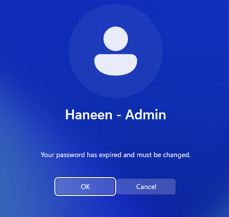
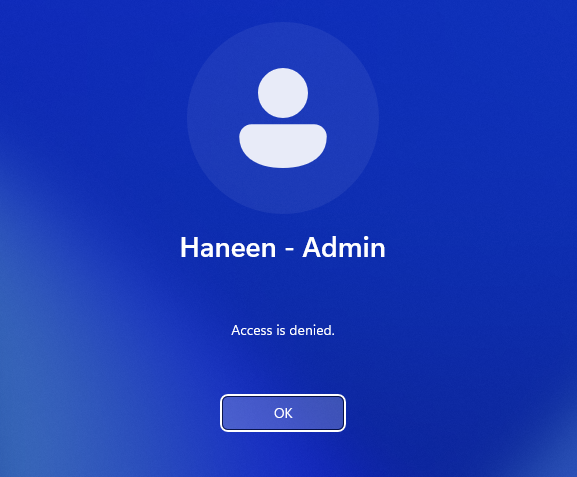
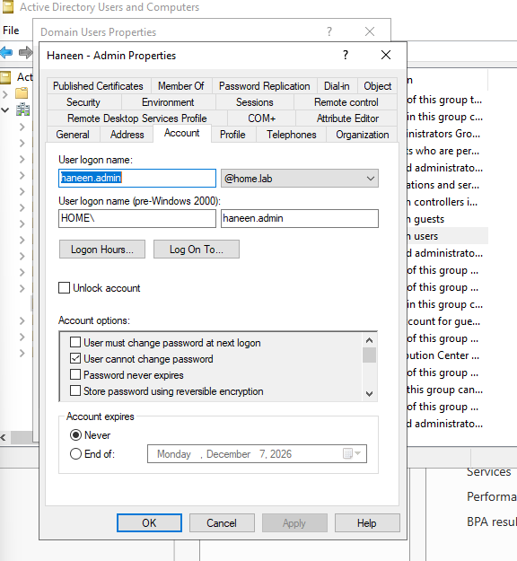
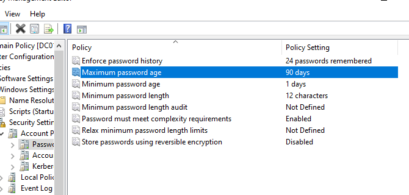
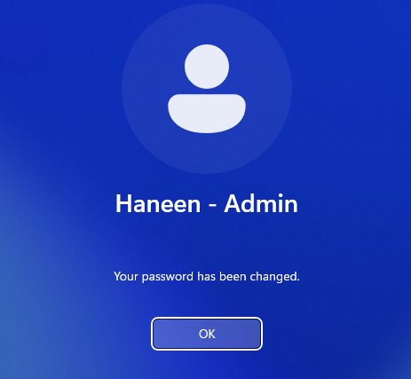

# Troubleshooting Experiences

## Intro 
Throughout configuring my Windows server and client, I have stumbled over many bumps. Some being VM-level bumps like having to learn how to creating my own virtual USB from a VMDK file to test out a GPO, and some being organizational level bumps within my domain like having to completely restructure my security groups to implement RBAC for file sharing. I've already talked about those however in my previous blogs (check 1.4 and 1.5). Here, I will talk about how I accidentally locked myself out of my Administrator Account on my Windows Client and the steps I took to resolve the issue.

## Encountering the Issue

For context, I took a very long break from working on this lab. I finally decided to get back on and, of course, tried to log in on the client using the account I always use, Haneen - Admin. This is the local Administrative account I have made for this mock-enterprise. Upon logging in with my usual password, I was told that it was time to do a password rotation. 

So I typed in a new password and...

I wasn't allowed to change my password. Well that seemed contradictive. I wasn't having an issue logging in to any other accounts however. I decided to do some investigating on the server end. 

## Investigation

Being that my user account is specific was having issues, I decided to start there. I selected my account from the Domain Users list and browsed through all of my settings. I took a look at my account tab and spotted the issue immediately. 

My account was set to not allow password changes. A tad of an issue considering my domain-wide password policy has a requirement of a password change every 90 days (as shown below).

After unchecking the box, I gave signing in to the account another go. 

Thankfully, the password change was permitted, and I was able to log in to my account once more. 

## Conclusion

This shows the importance of ensuring that accounts have the correct settings in place upon creation, and during periodic checks. The local IT administrator not being able to access their account could become a serious issue, as administrators need to be able to maintain access to their accounts to manage and troubleshoot the company's systems. It also shows why small configuration mistakes can have bigger consequences and why regularly reviewing account settings is important.

Next, we create and configure [the enterprise pfSense VM!](../02-windows-client/2.1-join-domain.md)
